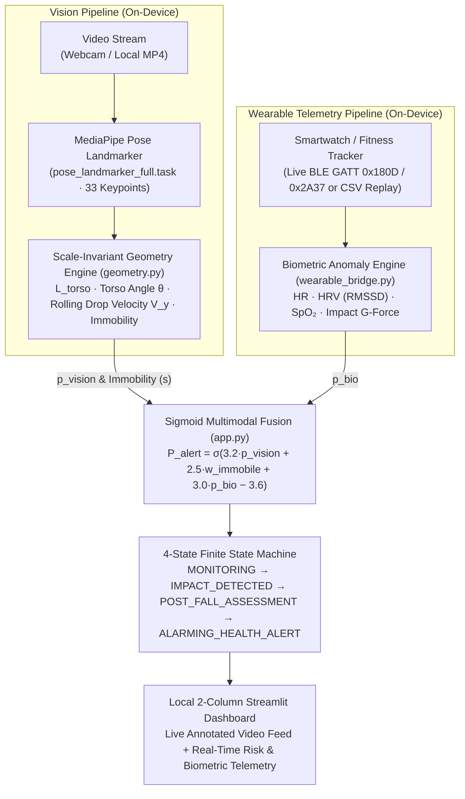

# EdgeGuard: 100% Offline Multimodal Fall & Acute Health Risk Detection System

[](https://www.python.org/)
[](https://ai.google.dev/edge/mediapipe/solutions/vision/pose_landmarker)
[](#executive-overview--value-proposition)
[-0082FC?logo=bluetooth&logoColor=white)](https://www.bluetooth.com/specifications/specs/heart-rate-service-1-0/)
[](https://streamlit.io/)

---

## Executive Overview & Value Proposition

Unimodal safety monitors struggle with a fundamental trade-off between **false alarms** and **missed emergencies**:

- **Camera-Only Systems** frequently trigger false positives during benign everyday behaviors—such as lying on a floor mat, stretching, tying shoes, or sitting down quickly—because skeletal posture alone cannot distinguish a controlled movement from an acute medical collapse.
- **Standalone Wearables** suffer from critical blind spots: wrist accelerometers miss low-impact falls (such as syncope, slow slumping, or sliding out of a chair), trigger spurious alerts during vigorous hand motion, and cannot visually verify post-fall horizontal posture or prolonged immobility.

**EdgeGuard** solves both failure modes by fusing **real-time scale-invariant skeletal pose geometry** with **wearable physiological telemetry** through a calibrated logistic risk model and 4-state Finite State Machine (FSM).

### Privacy-by-Design, Zero-Cloud Edge Architecture
- **100% Local Processing:** Every frame from the webcam or local video, all 33 MediaPipe Pose keypoints, and all biometric streams are processed strictly in RAM on the host machine—**raw video never leaves the device**.
- **Zero Cloud Latency & Zero API Costs:** Eliminates network round-trips, cloud inference bills, third-party vendor lock-in, and internet downtime risks. EdgeGuard operates identically in full airplane mode.

---

## System Architecture & Pipeline



---

## Key Technical Features

### 1. Scale-Invariant Computer Vision (`geometry.py`)
`FallGeometryEngine` extracts core anatomical landmarks—**nose (`0`)**, **shoulders (`11`, `12`)**, and **hips (`23`, `24`)**—to compute camera-distance-invariant kinematic features:

- **Torso-Length Normalization ($L_{\text{torso}}$):** Measures the Euclidean distance between the shoulder midpoint and hip midpoint ($L_{\text{torso}} = \|\mathbf{p}_{\text{shoulder}} - \mathbf{p}_{\text{hip}}\|_2 + \epsilon$). Normalizing motion and velocity by $L_{\text{torso}}$ keeps thresholds consistent whether the subject is 1 meter or 5 meters from the lens.
- **Torso Inclination Angle ($\theta$):** Computes the angle of the torso vector relative to the vertical axis ($\theta = \operatorname{atan2}(|\Delta x|, -\Delta y)$ in image coordinates). Postures exceeding $\theta > 65^\circ$ are flagged as horizontal (`is_horizontal = True`) and render a red skeleton overlay.
- **Rolling Hip Drop Velocity ($V_y$):** Tracks vertical hip midpoint displacement across a rolling **0.5-second `deque` buffer**, normalized by torso length: $V_y = \frac{\Delta y_{\text{hip}} / L_{\text{torso}}}{\Delta t}$.
- **Post-Fall Immobility Tracking:** Measures mean frame-to-frame displacement of the core landmarks (nose, shoulder midpoint, hip midpoint) relative to $L_{\text{torso}}$. While horizontal with normalized movement below `0.025`, the immobility timer accumulates continuously in seconds and resets once the person returns upright.
- **Vision Fall Probability ($p_{\text{vision}} \in [0.0, 1.0]$):** Combines angle severity ($\theta > 45^\circ$) and downward drop velocity ($0.65 \cdot s_{\text{angle}} + 0.35 \cdot s_{\text{velocity}}$), floored at `0.72` during confirmed horizontal posture.

### 2. Dual-Mode Wearable Telemetry Bridge (`wearable_bridge.py`)
`WearableBridge` decouples physiological ingestion from the UI loop via thread-safe state sharing (`threading.Lock`) and supports two operating modes:

- **Live BLE Smartwatch (`bleak`):** Launches an asynchronous `asyncio` worker inside a background daemon thread, discovers Bluetooth Low Energy peripherals advertising the standard **GATT Heart Rate Service (`0x180D`)** (or common wearable name prefixes), and subscribes to **Heart Rate Measurement (`0x2A37`)** notifications. Parses both 8-bit and 16-bit HR payloads and computes rolling **RMSSD HRV** automatically when RR-intervals are present in the BLE packet.
- **Deterministic Simulated Replay (`assets/sample_telemetry.csv`):** Loops in real time over an 11-second physiological sequence for repeatable, hardware-free testing:
  | Timeline | Phase | HR (BPM) | HRV RMSSD (ms) | SpO₂ (%) | Wrist Accel (g) |
  | :--- | :--- | :---: | :---: | :---: | :---: |
  | **0–4s** | Normal Resting Baseline | 71–75 | 45–49 | 98 | 0.99–1.05 |
  | **5s** | Fall Impact Spike | 112 | 28 | 96 | **3.45** |
  | **6–10s** | Post-Fall Tachycardia & Autonomic Shock | 128–145 | 21–14 | 95–91 | 1.00–1.12 |
- **Biometric Anomaly Risk ($p_{\text{bio}} \in [0.0, 1.0]$):** Weighted composite score across heart-rate spikes ($\ge 95\text{ BPM}$) or bradycardia ($< 50\text{ BPM}$), suppressed HRV ($< 35\text{ ms}$), SpO₂ desaturation ($< 95\%$), and high-G wrist impact ($> 2.5g$):
  $$p_{\text{bio}} = \operatorname{clip}\!\left(0.35\,s_{\text{HR}} + 0.25\,s_{\text{HRV}} + 0.20\,s_{\text{SpO}_2} + 0.20\,s_{\text{impact}},\; 0,\; 1\right)$$

### 3. Probabilistic Risk Fusion & Alert Tiers (`app.py`)
`fuse_risk_and_fsm()` combines visual fall likelihood, normalized immobility weight ($w_{\text{immobile}} = \min(1.0,\; t_{\text{immobile}} / 6.0)$), and physiological distress via a calibrated logistic sigmoid:

$$P_{\text{alert}} = \sigma\!\left(3.2\,p_{\text{vision}} + 2.5\,w_{\text{immobile}} + 3.0\,p_{\text{bio}} - 3.6\right), \quad \sigma(z) = \frac{1}{1 + e^{-z}}$$

| FSM State | Alert Tier | Trigger Condition | Clinical / Operational Meaning |
| :--- | :--- | :--- | :--- |
| `MONITORING` | **Normal** | $p_{\text{vision}} < 0.55$ and $P_{\text{alert}} < 0.40$ | Subject upright with baseline physiological telemetry. |
| `IMPACT_DETECTED` | **Tier 1** | Fall posture/impact detected, $P_{\text{alert}} < 0.70$, immobility $< 4.0\text{s}$ | Mechanical fall with stable vitals; monitor for recovery. |
| `POST_FALL_ASSESSMENT` | **Tier 2** | $0.70 \le P_{\text{alert}} < 0.85$ or immobility $\ge 4.0\text{s}$ | Suspected injury or prolonged post-fall immobility. |
| `ALARMING_HEALTH_ALERT` | **Tier 3** | $P_{\text{alert}} \ge 0.85$ | Critical acute health event combining fall/immobility with severe biometric distress. |

---

## Repository Structure

```text
edgeguard/
├── app.py                       # 2-column Streamlit dashboard, MediaPipe VIDEO loop & Sigmoid FSM
├── geometry.py                  # FallGeometryEngine (L_torso, θ, rolling V_y, immobility, p_vision)
├── wearable_bridge.py           # WearableBridge (Live BLE GATT 0x180D/0x2A37 + CSV Replay + p_bio)
├── assets/
│   └── sample_telemetry.csv     # 11-second synthetic telemetry timeline (resting → impact → shock)
├── pose_landmarker_full.task    # MediaPipe Pose Landmarker (Full) on-device model weights
├── requirements.txt             # Pinned Python dependencies
├── .gitignore                   # Excludes virtual environments, caches, and local test videos
└── README.md                    # Architecture documentation & setup guide
```

---

## Quickstart & Offline Verification

### 1. Clone & Set Up Virtual Environment

```bash
git clone https://github.com/<your-username>/edgeguard.git
cd edgeguard
python3 -m venv venv
source venv/bin/activate        # macOS / Linux
# venv\Scripts\activate         # Windows
```

### 2. Install Dependencies

```bash
pip install -r requirements.txt
```

### 3. Download MediaPipe Pose Landmarker Weights (One-Time Setup)

If `pose_landmarker_full.task` is not already in the project root, download the official full-precision model once before going offline:

```bash
curl -L -o pose_landmarker_full.task \
  https://storage.googleapis.com/mediapipe-models/pose_landmarker/pose_landmarker_full/float16/latest/pose_landmarker_full.task
```

### 4. Launch the Dashboard

```bash
streamlit run app.py
```

*(Ensure your terminal/IDE has OS camera permissions—and Bluetooth permissions on macOS when using Live BLE mode.)*

### 5. Testing Modes & Zero-Network Verification

- **Simulated Replay Mode (No Hardware Required):**
  1. In the left sidebar, set **Wearable Telemetry Source** to `Simulated Replay`.
  2. Choose `Live MacBook Webcam` (or select `Upload Test Video (.mp4)` to replay a local test clip).
  3. Toggle **Start EdgeGuard Engine** ON.
  4. Stand upright to observe `MONITORING` (green skeleton), then lean past `65°` / lie horizontally and remain still as the 11-second telemetry loop cycles through the `3.45g` impact (second 5) and post-fall tachycardia/shock (seconds 6–10) to watch transitions across **Tier 1 → Tier 2 → Tier 3**.

- **Live BLE Smartwatch Mode:**
  1. Enable heart-rate broadcast on any standard BLE Heart Rate strap or smartwatch supporting GATT `0x180D` (e.g., Polar, Garmin, Wahoo, or BLE HR simulator).
  2. Select `Live BLE Smartwatch` in the sidebar and toggle **Start EdgeGuard Engine** ON.
  3. Confirm the right-column caption updates from `Scanning BLE (0x180D)...` to your device name and streams live BPM (and RMSSD HRV if RR-intervals are broadcast).

- **100% Offline Verification:**
  1. Turn **off Wi-Fi** and disconnect Ethernet completely.
  2. Launch `streamlit run app.py` and toggle **Start EdgeGuard Engine** ON.
  3. Confirm local webcam capture, `pose_landmarker_full.task` inference, skeleton overlays, telemetry ingestion (CSV or BLE), and FSM tier updates run smoothly with zero network activity.

---

## Engineering & Medical Disclaimer

> [!CAUTION]
> **Not a Certified Medical Device:** EdgeGuard is an AI/ML engineering prototype developed strictly for research, technical portfolio demonstration, and educational purposes. It has **not** been clinically validated, evaluated, or cleared by the FDA, CE, or any other healthcare regulatory authority. Do **not** rely on this software for clinical diagnosis, patient monitoring, fall prevention, emergency dispatch, or any life-safety application.
